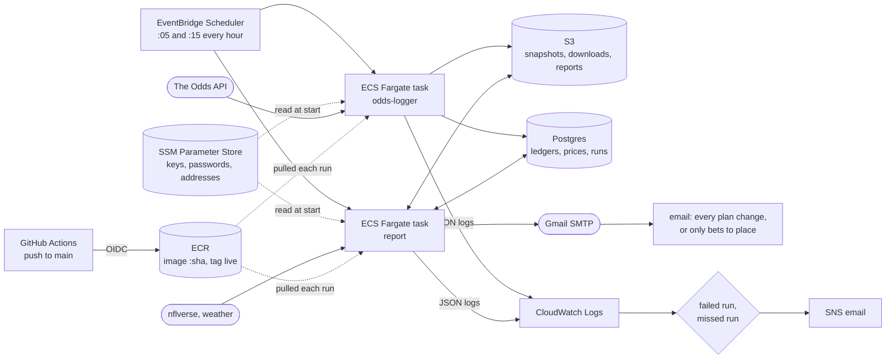

# nfl-alt-lines

A production data pipeline for NFL alternate betting lines: it logs prices from nine sportsbooks and prediction
markets every hour, prices every alternate line against a model, keeps a graded ledger with closing line value
and calibration, and emails a betting plan, all on AWS for about $1-2 a month.

**This is the public mirror of a private repository** ([BUILD_LOG.md](BUILD_LOG.md) has the history). Everything that runs the system is here: the logger,
storage, database, ledger, grading, emails, infrastructure, CI/CD and tests. The production *strategy* (the
model, its features, the selection rules and the stakes) is private. In its place this repo runs a public
**baseline strategy** behind the same interface, so the whole pipeline works end to end; it simply has no
opinion and never recommends a bet. See [How the private model plugs in](#how-the-private-model-plugs-in).

## How it runs



- **Odds logger (:05):** snapshots each game's alternate spreads, totals and player props inside a window before
  kickoff, a closing snapshot at the last run before kickoff (for closing line value), and every book's main
  lines every three hours (line movement), within an API credit budget.
- **Report (:15):** prices every alternate line 6-21 points against the bettor at each book, ranks it through
  the strategy, writes the ledger, grades finished games (profit, closing line value, Brier score, log loss,
  reliability), and emails a plan with the best price and book for each bet. A private weekly results email
  reports stakes and profit as shares of the bankroll.
- **Observability:** one JSON log line per event with a run id, a `runs` table row per execution, stage timings,
  and CloudWatch alarms on a failed run and on a missed run.

[infra/README.md](infra/README.md) is the runbook: Terraform modules for the network, storage, ECR, the
scheduled Fargate jobs and IAM, remote state with S3-native locking, and offline `terraform test` with a mock
provider.

## How the private model plugs in

The app never imports a model. It asks `nfl_alt_lines/strategy.py` for the installed strategy, found through a
Python entry point (`nfl_alt_lines.strategies`): a frozen interface for features, the ranker per week (fitted
on earlier weeks only), buckets, the round robin's leg rule, the props model, and the stakes.

- `nfl_alt_lines/baseline.py` (here): each line priced at its historical base rate; every game at the 50th
  percentile, so nothing is flagged.
- The production strategy (private): a separate package that registers the same entry point and is preferred
  when installed. Production's output is checked byte for byte whenever code moves between the two.

[docs/open-core-setup.md](docs/open-core-setup.md) describes the setup: the private repo is the source of
truth, and this mirror is exported from an allowlist, with every file checked for private names before it is
published.

## Setup

```sh
uv sync --all-packages
cp .env.example .env   # then fill in the values
uv run nfl-alt-lines odds-logger --dry-run
uv run nfl-alt-lines report
```

`.env` holds `ODDS_API_KEY` (The Odds API), and optionally `SMTP_USER` and `SMTP_APP_PASSWORD` for the email.
Files live in `data/` or S3 (`STORAGE_BACKEND=s3`), the ledgers in SQLite or Postgres (`DATABASE_URL`).

## Docker

One image (multi-stage, non-root), two jobs; settings arrive as environment variables, never baked in:

    docker compose build
    docker compose run --rm odds-logger --dry-run
    docker compose run --rm report

`docker-compose.cloud.yml` stands in for the cloud locally: S3 is a moto server and the database is Postgres.

## Development

All code follows [CODE_QUALITY_RULES.md](CODE_QUALITY_RULES.md).

    uv run ruff check . && uv run ruff format --check .
    uv run mypy                                        # strict
    uv run bandit -c pyproject.toml -r .
    uv run pytest --cov                                # includes tests/test_structure.py; 90% floor

CI runs these on every push and pull request, plus `terraform fmt`, `validate` and `test`, a Docker build with
smoke tests, and a TruffleHog scan; Dependabot proposes updates weekly.

Nothing here is betting advice, and the baseline strategy bets nothing.
